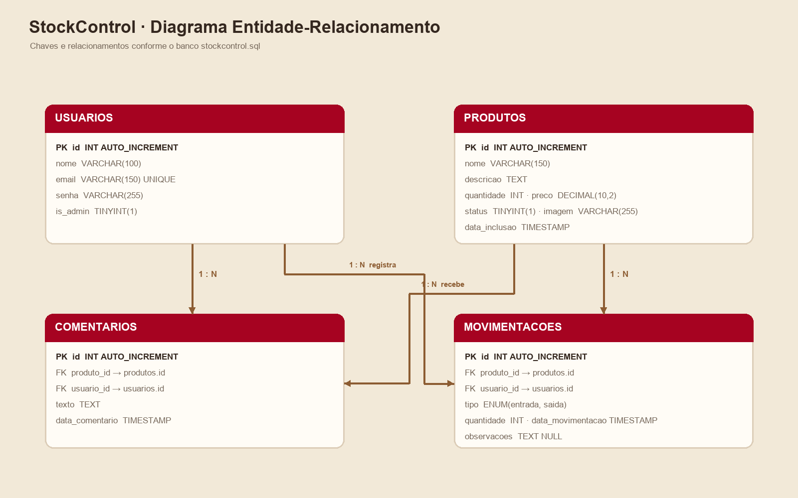
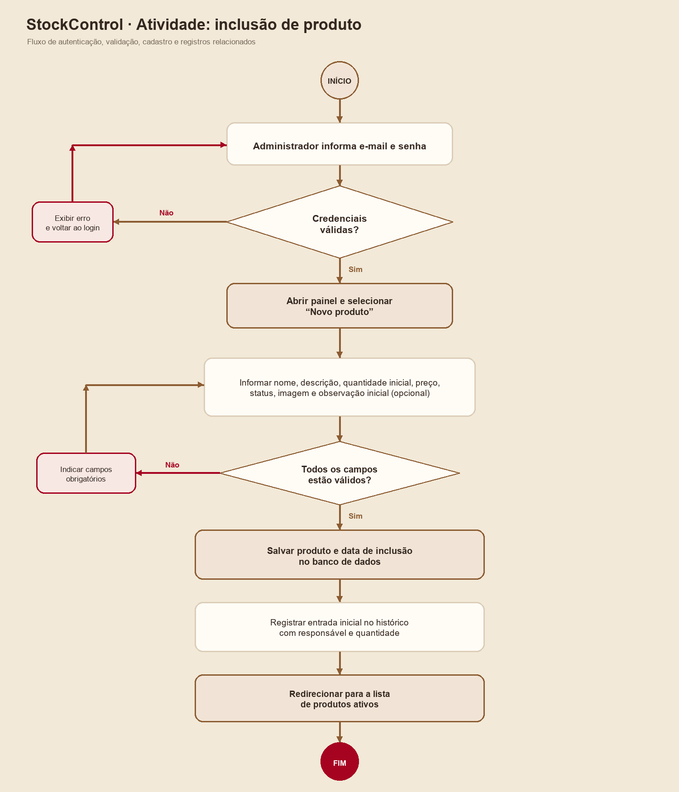

<div align="center">
  
  <p><strong>Controle de estoque simples, visual e direto.</strong></p>
  <p>Aplicação web para acompanhar produtos, quantidades, movimentações e comentários em um único lugar.</p>
</div>

---

## Visão geral

O StockControl é um sistema de controle de estoque desenvolvido em PHP e MySQL/MariaDB para execução local com XAMPP. A interface oferece áreas distintas para administração e consulta por funcionários.

### Recursos

- Painel administrativo com indicadores de estoque, catálogo e movimentações recentes.
- Cadastro, edição e exclusão de produtos, com envio de imagem.
- Registro de entradas e saídas com atualização da quantidade disponível.
- Área de funcionário para consultar produtos, preços e quantidades.
- Comentários e histórico de movimentação por produto.
- Busca de produtos, filtros do histórico e avisos de estoque baixo.
- Interface responsiva para computador e dispositivos móveis.

## Tecnologias

- PHP 8.2 ou superior
- MySQL ou MariaDB
- PDO com driver `pdo_mysql`
- Apache (XAMPP)
- HTML, CSS e JavaScript sem dependências de build

## Instalação local

1. Coloque a pasta do projeto dentro de `htdocs` do XAMPP, por exemplo:

   ```text
   C:\xampp\htdocs\stock\Stock_Control
   ```

2. Abra o painel do XAMPP e inicie **Apache** e **MySQL**.
3. Acesse o phpMyAdmin em `http://localhost/phpmyadmin`.
4. Crie um banco de dados chamado **`stockcontrol`**.
5. Selecione esse banco e importe `database/stockcontrol.sql`.
6. Confira em `config.php` se a conexão está configurada para o banco `stockcontrol`, usuário `root` e senha vazia (padrão local do XAMPP).
7. Abra o projeto no navegador. Para o exemplo acima, use:

   ```text
   http://localhost/stock/Stock_Control/
   ```

O Apache precisa ter permissão de escrita na pasta `imagens/` para salvar fotos enviadas pelo formulário.

## Contas locais de demonstração

O dump SQL inclui duas contas para testes locais:

| Perfil | E-mail | Senha |
| --- | --- | --- |
| Administrador | `admin@stockcontrol.com` | `admin123` |
| Funcionário | `carlos@stockcontrol.com` | `user123` |

Essas credenciais são destinadas somente à instalação local. Altere as senhas antes de qualquer uso fora do ambiente de demonstração. A senha administrativa legada é convertida para hash quando ocorre o primeiro login.

## Banco de dados

O esquema usa as tabelas `usuarios`, `produtos`, `movimentacoes` e `comentarios`. O diagrama abaixo resume os relacionamentos:

<div align="center">
  
</div>

Se o banco já tiver sido importado antes da inclusão das imagens de exemplo, execute `database/atualizar_imagens.sql` no phpMyAdmin. Esse script atualiza os caminhos das fotos sem apagar os registros existentes.

## Fluxo de cadastro de produto

<div align="center">
  
</div>

## Estrutura do projeto

```text
Stock_Control/
├── assets/          # estilos, marca e scripts da interface
├── database/        # dump do banco e atualização das imagens
├── docs/            # diagramas e documentação visual
├── imagens/         # fotos de exemplo e imagens enviadas
├── config.php       # conexão PDO com MySQL/MariaDB
├── index.php        # login e painel administrativo
├── estoque.php      # consulta de estoque para funcionários
└── movimentacoes.php # histórico completo de entradas e saídas
```

## Observações

- Não há gerenciador de pacotes: os recursos da interface são próprios do projeto.
- As imagens de exemplo são arquivos WebP armazenados em `imagens/`.
- O esquema acompanha as tabelas fornecidas para a atividade e não adiciona categorias ou imagens de perfil.